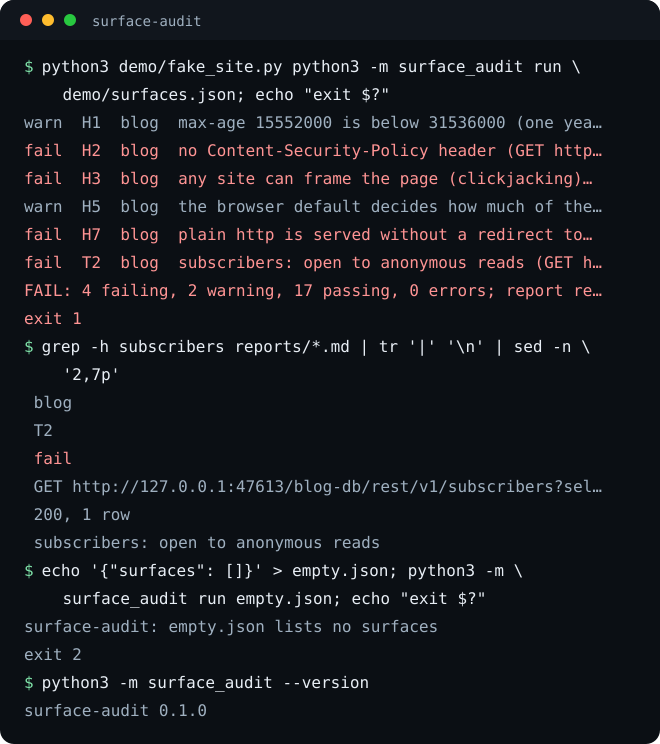

# surface-audit

surface-audit checks the websites and databases you run for the holes a defender looks at first: missing or weak security headers, database tables that answer rows to the public key, data routes that answer without a session, secrets in the files a browser downloads, and env or key files committed to git. It only reads, and it writes a dated report in which every row names the exact request sent and the answer that decided it, so a second person can re-run any row by hand.

**Run it only against surfaces you own or have written permission to test.**

[](https://github.com/eliferres/surface-audit/actions/workflows/ci.yml)




## Install and first run

```bash
pipx install git+https://github.com/eliferres/surface-audit
surface-audit run surfaces.json
```

It is not on PyPI; that line installs from this repository. To try it from a clone with no install step, run the demo, which starts a fake site and database on 127.0.0.1:47613 for the length of one command:

```bash
git clone https://github.com/eliferres/surface-audit.git
cd surface-audit
python3 demo/fake_site.py python3 -m surface_audit run demo/surfaces.json
```

```text
warn  H1  blog  max-age 15552000 is below 31536000 (one year) (GET http://127.0.0.1:47613/blog/)
fail  H2  blog  no Content-Security-Policy header (GET http://127.0.0.1:47613/blog/)
fail  H3  blog  any site can frame the page (clickjacking) (GET http://127.0.0.1:47613/blog/)
warn  H5  blog  the browser default decides how much of the URL other sites see (GET http://127.0.0.1:47613/blog/)
fail  H7  blog  plain http is served without a redirect to https (HEAD http://127.0.0.1:47613/blog/)
fail  T2  blog  subscribers: open to anonymous reads (GET http://127.0.0.1:47613/blog-db/rest/v1/subscribers?select=*&limit=1 (public key, no session))
FAIL: 4 failing, 2 warning, 17 passing, 0 errors; report reports/2026-10-12-0954-ba43b9.md
```

The console shows every row that is not a pass; the report in `reports/` holds all 23 rows, passes included. Python 3.9 or newer, standard library only.

## Rules

Each rule gives one row per page, table, route or file it checks, graded pass, warn or fail. Only a fail changes the exit code.

| Rule | What it checks | Why |
|---|---|---|
| `H1` | `Strict-Transport-Security` with a max-age of at least 15552000 (180 days); below 31536000 (one year) is a warning, missing or shorter is a failure | Without it a browser's first visit can go over plain http, where it can be intercepted. One year is the minimum the browsers' HSTS preload list accepts. |
| `H2` | A `Content-Security-Policy` header; `'unsafe-inline'` or `'unsafe-eval'` for scripts (in `script-src`, or `default-src` when there is none), or `default-src *`, is a warning | The policy is the browser's second line against injected script. A `Report-Only` policy blocks nothing and does not count. |
| `H3` | `frame-ancestors` in the policy naming `'none'`, `'self'` or specific origins, or, with no `frame-ancestors`, `X-Frame-Options` of `DENY` or `SAMEORIGIN`; `*`, a bare scheme such as `https:` or an empty list fails | Otherwise any site can load the page in a frame and trick a click (clickjacking). |
| `H4` | `X-Content-Type-Options: nosniff` | Stops a browser from guessing that an uploaded text file is script and running it. |
| `H5` | A `Referrer-Policy` header; a warning when missing | Decides how much of a URL, tokens in query strings included, other sites receive. |
| `H6` | A `Permissions-Policy` header; a warning when missing | Turns off camera, microphone and location for the page and anything it embeds. |
| `H7` | A plain `http://` request to each host is redirected to `https://` | A site still served over http can be read and changed in transit. |
| `T1` | The database lists its tables in its OpenAPI description; when that is closed, the config's `tables` list is used and the row is a warning; with neither, the row fails | A table nobody listed is a table nobody checked. |
| `T2` | Each table, asked for one row with the public key and no session, returns none; rows fail unless the table is in `public_tables` | The public key ships in the site's JavaScript, so this is what any stranger can read. |
| `R1` | Each URL in `must_refuse` answers 401 or 403 to a request with no session; any 2xx fails, anything else is a warning that shows the status | A data route that answers without a session serves its data to everyone. |
| `S1` | No service-role JWT, Anthropic API key (`sk-ant` prefix), Stripe live secret key (`sk_live_`), AWS access key id (`AKIA`), GitHub token (`ghp_`, `gho_`) PEM private key or Supabase secret key (`sb_secret_`) in any file under `built_dir` | Everything in a built site folder is downloadable. A service-role key in the browser bypasses every table's row security. |
| `G1` | Git tracks no `.env` or `.env.*` file (`.env.example` and `.env.sample` aside) and no `.pem`, `.key`, `.p12` or `.pfx` file | A committed secret stays in the history after the file is deleted. |

An `error` row means no verdict: the surface did not answer, a file could not be read, or git did not run. Any error row makes the exit code 2, so a site that is down never reads as a pass.

## Configuration

The config is one JSON object with a `surfaces` list. Relative folders are read from the config file's own folder.

```json
{
  "surfaces": [
    {
      "name": "shop",
      "urls": ["https://shop.example.com/", "https://shop.example.com/account"],
      "postgrest_url": "https://abcdefgh.supabase.co",
      "anon_key": "<the public anon key your site ships>",
      "public_tables": ["products"],
      "must_refuse": ["https://shop.example.com/api/orders"],
      "built_dir": "../shop/out",
      "repo_dir": "../shop"
    }
  ]
}
```

| Field | Meaning |
|---|---|
| `name` | Required. The surface's name in every row; unique in the file. |
| `urls` | Pages to grade with H1 to H6. Each is fetched with GET, following up to five redirects, and the final URL is reported. List every path whose headers matter: a page, an API route, a static file. |
| `skip` | Header rules (`H1` to `H7`) not to grade on this surface, such as `H2` for an API host that serves no HTML. Skipped rules still get a row that says so. |
| `http_url` | The plain-http address H7 asks. Defaults to `http://<host>/` for each host in `urls`. |
| `postgrest_url` | The project URL of a PostgREST or Supabase database; the tool asks `<postgrest_url>/rest/v1/`. Needs `anon_key`. |
| `anon_key` | The public key the site's browser code uses: Supabase's anon JWT or its newer `sb_publishable_` key. A key that bypasses row security, a JWT carrying the `service_role` claim or an `sb_secret_` key, is refused before any request. |
| `tables` | Tables to check in addition to those the OpenAPI description lists, and the whole list when the description is closed. |
| `public_tables` | Tables meant to be readable by anyone, such as a product catalog. Rows from these pass. |
| `must_refuse` | Data routes that must answer 401 or 403 to a request with no session. Redirects are not followed. |
| `built_dir` | The folder of the built site (`out/`, `dist/`) to scan for secrets. |
| `repo_dir` | A git checkout whose tracked files are checked by G1. |

An unknown field is an error, so a typo such as `public_table` stops the run instead of failing a table you meant to allow.

## Usage

```text
surface-audit run CONFIG [--json] [--out DIR]
surface-audit --version
```

**`--out DIR`** writes the report to `DIR` instead of `reports/` in the current directory. The file is named `<YYYY-MM-DD>-<HHMM>-<6 random hex>.md`; a second run writes a new file and never overwrites one.

**`--json`** prints every row as `{"surface", "rule", "result", "request", "answer", "detail"}`, with the verdict, the counts and the report's path, for a CI step or a dashboard. The report file is written either way.

| Exit | Meaning |
|---|---|
| 0 | No failures. Warnings may be present. |
| 1 | One or more failures. |
| 2 | A configuration error (one line on stderr, no request sent), or a surface that did not answer: refused, reset twice, or not finished within 15 seconds. The 15 seconds cover the whole request, connect to last byte, so a server that sends one byte at a time cannot hold a run; the row reads `unreachable (timed out after 15 s)`. |

In CI, with the config committed beside the site:

```yaml
- name: Surface audit
  run: |
    pipx install git+https://github.com/eliferres/surface-audit
    surface-audit run surfaces.json
```

## How it works

**The public key is enough, and the right key.** The anon key of a Supabase or PostgREST project is in the site's JavaScript, so anyone has it. The database answers a request with that key and no user session with exactly the rows its row-level policies give the anonymous role. Asking every table for one row that way is the stranger's view, and needs no admin token. The key in the browser's network tab is not the hole; a table that answers it with rows is, and so is a service-role key shipped to the browser. That is also why the tool refuses a service-role key in its config: such a key bypasses row security, so its answers would say nothing about strangers, and the audit would become a reader of private data.

**"Closed to anonymous reads", never "RLS on".** The probe sees the answer, not the setting. A 401 means the anonymous role has no grant on the table. An empty list is what a table with row security and no matching policy returns, and also what a table without row security returns while it is empty. The report says what was observed. No row content is ever written to the report or the console, only the count.

**Why `'unsafe-inline'` is a warning.** Frameworks that inline their bootstrap scripts, Next.js among them, need `'unsafe-inline'` in `script-src` unless every page carries a nonce. Failing it would fail nearly every such site and teach people to ignore the exit code. The rest of the policy (`frame-ancestors`, `object-src`, `connect-src`, `base-uri`) still does real work, so a missing policy fails and a loose one warns.

**Read-only by construction.** Every request goes through one function that refuses any verb but GET and HEAD and carries no cookie. A test runs a full audit against a recording server and asserts the verbs it saw. Redirects are followed by hand so each hop is counted: pages follow up to five and report the final URL; H7 asks with HEAD (GET when a server refuses HEAD or answers it malformed, and the row names the verb that decided it) and stops at the first `https://` location without fetching it; R1 follows none, because a 302 to a login page that answers 200 would otherwise read as an open route.

**Secrets by shape, values never shown.** Each file is read in one-megabyte chunks with an 8 KB overlap, and a match that starts in the overlap is left for the next chunk, so a ten-megabyte bundle never sits in memory and a key across a chunk edge is found once. A JWT counts only when its payload's `role` claim is `service_role`; the public anon key is a JWT too and is meant to be there. The configured key is also allow-listed by its SHA-256. A hit is reported as the shape, the file and the byte offset.

## Limitations

- **One URL is never the whole site.** Headers are read from the URLs listed, and a CDN can answer each path differently. List the pages, API routes and static files that matter.
- **An empty answer proves row filtering, not the setting.** A table with no row security reads as closed while it holds no rows. Check the setting itself with your database's own security advisor after any schema change.
- **Only the anonymous role is asked.** Whether a signed-in user can read another user's rows is not tested.
- **No runtime-loaded scripts are seen.** S1 reads the built folder on disk. Scripts a page loads from other hosts, values injected at runtime and environment variables on the server are outside it. A policy set in a `<meta>` tag is not read either, so H2 and H3 can fail a page that sets one there.
- **A fixed list of secret shapes.** A key in a format not listed above is not found.
- **`'unsafe-inline'` warns even with a nonce.** Browsers ignore it when the same directive carries a nonce or hash; the tool does not make that exception.
- **The REST root is assumed at `/rest/v1/`**, as Supabase serves it. A PostgREST server whose root is elsewhere needs a proxy route at that path.
- **H7 asks the root of each host on port 80**, unless `http_url` names another address.

See [CONTRIBUTING.md](CONTRIBUTING.md) to report a wrong grade or propose a rule, and [SECURITY.md](SECURITY.md) for a problem in the tool itself. MIT licensed, see [LICENSE](LICENSE).
